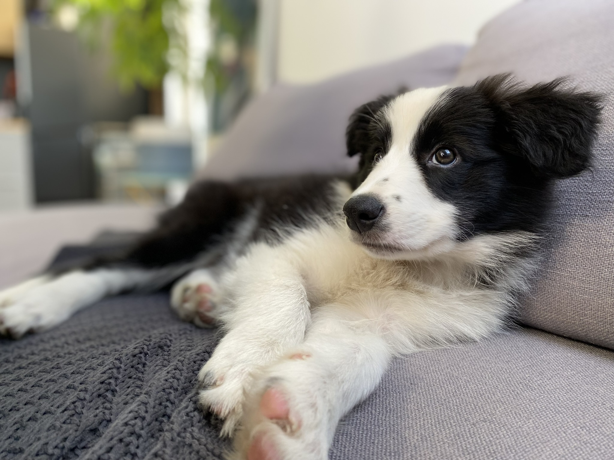
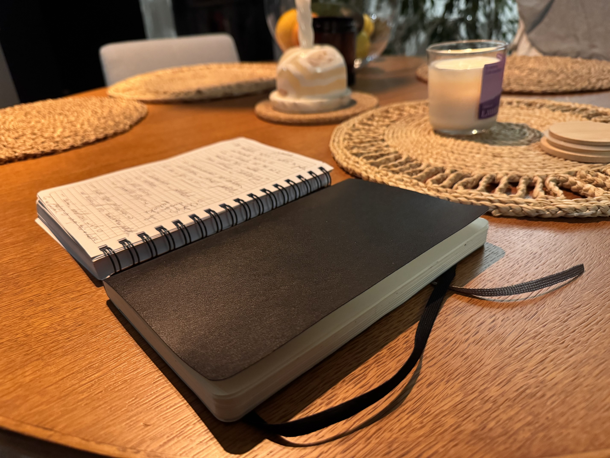

Nie będę ściemniał. W bojach z cyfrowym zaśmieceniem wciąż radzę sobie średnio. Może nie wpadam w kolejne królicze nory na Reddicie i nie scrolluję reelsów na Instagramie bez opamiętania, ale swoje mam za uszami. Na przestrzeni lat przetestowałem jednak wiele narzędzi i technik mających pomóc mi chronić czas i uwagę przed wrogimi algorytmami mediów społecznościowych. I choć faktycznie znalazłem kilka, które realnie poprawiły jakość mojego życia, to największą zmianę wygenerowała niespodziewanie zupełnie inna decyzja: przyjęcie do domu psa. 

### **Pies i analogowe życie**

Mańka, klasycznie czarno-biała suczka rasy border collie, pojawiła się w naszym domu w październiku 2021 roku z inicjatywy mojej żony. Basia od dziecka marzyła o posiadaniu psa i po latach udało jej się przekonać mnie do realizacji tego marzenia. W zasadzie, postawiłem całemu przedsięwzięciu tylko jeden warunek. Jako, że żadne z nas nie było wcześniej psim opiekunem, nie chciałem ryzykować przebojów z adopcją psa ze schroniska, którego traumy mogłyby przerosnąć nasze umiejętności. Zaproponowałem więc, by dołączył do nas szczeniak ze sprawdzonej hodowli. Wiadomo, liczyłem na miękkie lądowanie i integrację psa w naszą codzienność w sposób przewidywalny, spokojny i bezpieczny.

Jaki łatwo się domyślić, wyszło dokładnie na odwrót.

Pies wszedł w nasze życie razem z drzwiami, futryną i domem sąsiadów. Zero taryfy ulgowej, żadnego okresu przejściowego. Trafiła nam się totalna ancymonka, której nie interesowało, na co mamy ochotę i co akurat robimy. "Chcesz pograć w Cyberpunka? A co mnie to! Proszę się mną zająć teraz, bo jak nie, to wojna!" Dodatkowo, okazało się, że Mańka cierpi na mnóstwo różnych lęków i fiksacji. Zagadnia samochody i rowery, boi się większości innych piesków i części napotykanych na spacerach ludzi, a każdy niespodziewany dźwięk czy ruch generuje u niej stres i dyskomfort. Nie było więc wyjścia: musieliśmy zakasać rękawy i przebudować nasze rytuały, by wygospodarować dodatkowe godziny zarówno na organizację porządnego wypadu na spacer, jak i treningu niwelującego psie przypadłości. 

I choć może opisuję naszą historię z doggo, jakby była jakimś horrorem, to dla mnie okazała się ona zbawienna. Przede wszystkim, wyszło na jaw, że czas na ogarnianie Mańki znajduję bez problemu. Po prostu przestałem ślęczeć z nosem w ekranie. Szybko połapałem się, że choć czasem frustrująca i drenująca, to opieka nad doggo daje mi więcej radochy, niż binge-watching kolejnego średniego serialu na Netflixie. 

Wiem, wiem. Ameryka odkryta!

W każdym razie, przeboje z psem i ich niespodziewane konsekwencje dały mi mocno do myślenia i pchnęły mnie ku aktywnym poszukiwaniom kolejnych narzędzi radzenia sobie ze światem zawalonych bezwartościowym kontentem . Dwa z nich zadziałały lepiej, niż mógłbym się spodziewać. 

### Nuda i cisza

Przede wszystkim, polubiłem się z nudą. Przeczytanie *Stolen Focus* Johanna Hari'ego zachęciło mnie do aktywnego szukania okazji, by pobyć ze swoimi myślami w samotności i ciszy. Gdy wychodzę biegać albo biorę psa na spacer, zostawiam w domu słuchawki. Do niedawna, towarzyszyły mi one niemal na każdym kroku. Gdy jadę gdzieś samochodem, próbuję powstrzymać się przed odpaleniem najnowszego odcinka jednego ze swoich ulubionych podcastów. Nawet wieczory po pracy staram się częsciej spędzać z nosem w książce niż przed telewizorem, oglądając po raz kolejny najlepsze odcinki amerykańskiego The Office. *The Dinner Party* oglądałem conajmniej 50 razy. Na razie wystarczy. 

Znalezienie przestrzeni na nudę i obcowanie z nią w ciszy pozwala, by mój mózg mógł "odpłynąć" w kierunku swobodnej i kreatywnej eksploracji różnych tematów. W ciszy znajduję odpowiedzi na większość życiowych zagwozdeki, rozwiązania zawodowych wyzwań. Z nudów rozpisuje dziesiątki pomysłów na własne biznesy i analizy oglądanych filmów (których to analiz póki co jeszcze tu nie wrzucam). Idea *Mniej szumu* również zrodziła się w ciszy. ;) 

Oczywiście, świetnie wiem, że nudzić się jest strasznie trudno. Czasem wręcz bardzo niekomfortowo. Jednak na mnie, moją kreatywność i umiejętność skupienia, nuda i jej następstwa mają zbawienny wpływ. Poszukać sposobów na ponudzenie się polecam więc każdemu.

### Bullet journal

Gdy już je znajdziecie, szybko zauważycie ile wartościowych, oryginalnych myśli produkują Wasze mózgi. Wypadałoby zacząć je gdzieś zapisywać. Ja nawyk notowania wszystkiego wypracowałem lata temu, jednak z czasem, notatnik i długopis zastąpiłem aplikacją *Notes*, co ostatecznie nie wyszło mi na dobre. Po prostu, interakcje z aplikacją do notatek kończyły się u mnie zazwyczaj długimi sesjami ze smartfonem w ręku. 

Szukając sposobu na ich ograniczenie, po raz pierwszy od lat kupiłem notatnik z prawdziwego zdarzenia - minimalistyczny *bullet journal* od Moleskine. 

Dzięki notatnikowi wróciłem do bazgrania. Poza standardowym zapisywaniem spraw do załatwienia, czy kluczowych wątków z zawodowych spotkań, korzystam z niego, by zwyczajnie dać swojej wyobraźni się wyszumieć. W efekcie, jego końcowe strony wyglądają jak niegdyś moje licealne zeszyty. Są zapiasane nazwami zespołów muzycznych, ulubionych filmów, albo zupełnie randomowymi obrazkami, czy wzorkami. Nie jestem w stanie wytłumaczyć celu ich tworzenia. Bazgranie sprawia mi po prostu ogromną przyjemność, której od lat nie miałem okazji zaznać. 

Co ciekawe, wprowadzenie papierowego notatnika nie wyeliminowało wcale moich cyfrowych zapisków jak pierwotnie się spodziewałem. Spowodowało jednak, że stały się one dużo lepsze. Wykorzystując swój *bullet journal,* wypracowałem model tworzenia i ewaluacji własnych notatek, dzięki którymu więcej zapamiętuję i lepiej priorytetyzuję zadania - zarówno te w prywatnym jak i zawodowym życiu.  

Jak działa mój workflow? W zasadzie, jest bardzo prosty. Papierowy notatnik - a w zasadzie notatniki, bo obecnie prowadzę już dwa - traktuję jak swoiste brudnopisy. Trafia do nich wszystko, co w danym momencie uznaję za warte zapisania. Następnie, zazwyczaj w ciągu kilku dni, wracam do własnych notatek z zamiarem przepisania ich na cyfrowy format. Ten prosty rytuał cyklicznego i systematycznego przeglądania własnych notatek pozwala mi przemyśleć, co właściwie miałem na myśli zostawiając dany komentarz i zdecydować, czy jest on faktycznie warty uwiecznienia. Jednocześnie, wymusza on na mnie powrót do tematu, którego sama notatka dotyczy i ponowne jego przemyślenie. Efekty są świetne! Redagując własne notatki, nie tylko ewaluuję ich istotność i syntetyzuję treść, ale też dochodzę do nowych wniosków... lub kolejnych wątpliwości. Wszystko oczywiście zapisuję. :) 

### Co mi się nie udało?

Wciąż spędzam jednak sporo czasu przed ekranami. Wymaga tego nie tylko moja praca, ale i wiele z moich zainteresowań. Filmy oglądam nałogowo, ale przynajmniej ograniczyłem liczbę platform streamingowych, jakie subskrybuję. Poniedziałkowe poranki zawsze zaczynam od YouTube, gdyż nie jestem w stanie pożegnać się z The Last Week Tonight Johna Olivera. We wtorki z podobnym wyczekiwaniem odpalam nowy odcinek The Daily Show prowadzonego przez Jona Stewarda. O ile nie chcę rezygnować z oglądania żadnego z nich, to mam nadzieję, że uda mi się chociaż przenieść ich seanse na popołudnia. 

Posty do *Mniej szumu* piszę na komputerze. Korzystam jednak z aplikacji Typora, która w trybie skupienia umożliwia mi pracę nad treścią bez zbędnych dystrakcji. Nie potrafię natomiast zrezygnować na stałe z Instagrama i Reddita. Ewidentnie, odczuwam jakieś FOMO i szukam dopaminowych pętli nagród. Udało mi się przynajmniej zmniejszyć skalę interakcji z nimi poprzezi wprowadzanie limitów czasowych. A gdy sprawy idą za daleko, usuwam ich aplikacje z telefonu. Póki co, na jakiś czas. 

------

Polecam przeczytać:

- [Stolen Focus: Why You Can't Pay Attention — and How to Think Deeply Again](https://www.goodreads.com/book/show/57933306-stolen-focus)
- [Digital Minimalism: Choosing a Focused Life in a Noisy World](https://www.goodreads.com/book/show/40672036-digital-minimalism) 

Nice apps: 

- [Typora - minimalistyczny edytor tekstu i czytnik Markdown](https://typora.io/)
